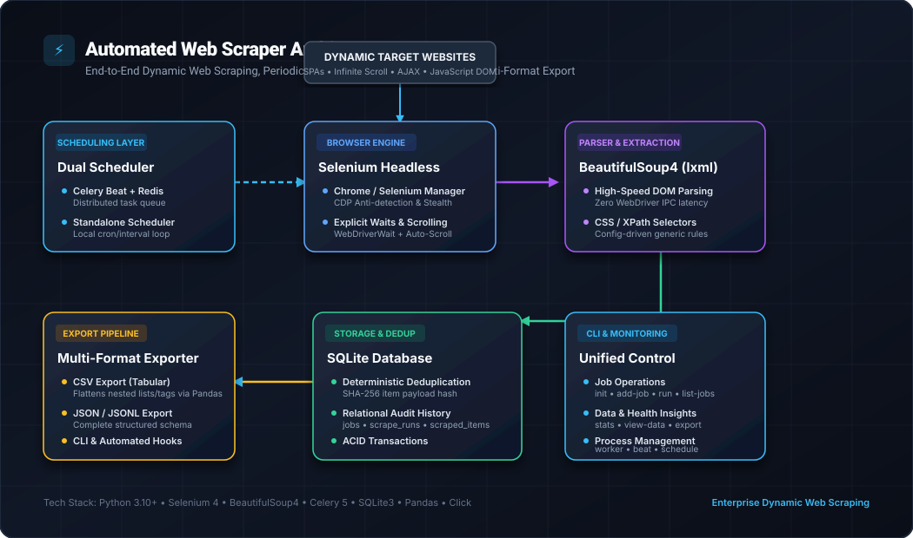

# Automated Web Scraper with Scheduler


An automated web scraping tool built with **Python, Selenium, BeautifulSoup4, Celery, and SQLite**. It collects data from dynamic websites, schedules recurring scraping jobs, prevents duplicate records, stores results in a database, and exports datasets to CSV and JSON.

The project supports JavaScript-rendered pages, configurable CSS selectors, and two scheduling modes: a standalone local scheduler and an optional Celery-based distributed scheduler.

## Features

- **Dynamic scraping:** Selenium and headless Chrome handle JavaScript-rendered pages, explicit waits, and dynamic content.
- **HTML parsing:** BeautifulSoup4 with lxml extracts structured data from rendered HTML.
- **Duplicate prevention:** SHA-256 hashes help identify duplicate scraped records.
- **SQLite storage:** Stores scraping jobs, execution history, metrics, and collected items.
- **Automated scheduling:** Run recurring jobs using the standalone scheduler or Celery Beat and workers.
- **Configurable scrapers:** Includes Quotes, e-commerce catalog, and generic CSS-selector-based scraping.
- **Data export:** Export collected records to CSV or JSON.
- **Command-line interface:** Initialize the database, manage jobs, run scrapes, inspect statistics, and export results.
- **Testing:** Includes unit, integration, and live browser scraping tests.

## Architecture



### Data pipeline

1. **Source website:** A dynamic website provides the content.
2. **Browser automation:** Selenium loads the page and renders JavaScript.
3. **HTML extraction:** BeautifulSoup4 and lxml parse the rendered page.
4. **Deduplication:** SHA-256 hashes identify duplicate records.
5. **Database:** SQLite stores items and execution history.
6. **Export:** The exporter produces CSV or JSON files.

The standalone scheduler runs locally without Redis. The optional distributed scheduling configuration uses Celery and Redis.

## Technology Stack

| Technology | Purpose |
|---|---|
| Python | Application logic and orchestration |
| Selenium | Browser automation and dynamic content rendering |
| BeautifulSoup4 | HTML parsing and extraction |
| lxml | Fast HTML parsing |
| Celery | Distributed task execution |
| Redis | Message broker for Celery |
| SQLite | Persistent local storage |
| Docker Compose | Containerized services |
| pytest | Automated testing |

## Project Structure

```text
automated_web_scraper/
├── core/
│   ├── engine.py
│   ├── parser.py
│   └── scrapers/
│       ├── base.py
│       ├── quotes_scraper.py
│       ├── ecommerce_scraper.py
│       └── dynamic_generic.py
├── tests/
│   ├── test_database.py
│   ├── test_e2e_live.py
│   ├── test_exporter.py
│   ├── test_parser.py
│   └── test_scrapers.py
├── assets/
│   ├── architecture_diagram.svg
│   └── cli_preview.svg
├── samples/
├── tasks/
├── config.py
├── database.py
├── exporter.py
├── celery_app.py
├── scheduler.py
├── cli.py
├── requirements.txt
├── Dockerfile
├── docker-compose.yml
└── README.md
```

*Note: This structure reflects the documented project layout. Verify the filenames and folders against your actual repository before publishing.*

## Getting Started

### Prerequisites

- Python 3.10 or later
- Google Chrome or a compatible Chromium browser
- Git

For distributed scheduling, you'll also need Redis and a working Celery configuration. Docker can simplify setting up the required services.

### 1. Clone the repository

```bash
git clone https://github.com/singipurapudinesh-coder/automated-web-scraper.git
cd automated-web-scraper
```

### 2. Install dependencies

```bash
python -m venv .venv
```

Activate the environment on Windows:

```powershell
.venv\Scripts\Activate.ps1
```

Install the dependencies:

```bash
python -m pip install -r requirements.txt
```

### 3. Initialize the database

```bash
python cli.py init
```

### 4. List available jobs

```bash
python cli.py list-jobs
```

### 5. Run a scraping job

```bash
python cli.py run quotes_sample
```

### 6. View collected data and statistics

```bash
python cli.py view-data --job quotes_sample --limit 5
python cli.py stats --job quotes_sample
```

### 7. Export results

Export to CSV:

```bash
python cli.py export --job quotes_sample --format csv
```

Export to JSON:

```bash
python cli.py export --job quotes_sample --format json
```

The CLI reports the output location of generated export files.

## Scheduling

### Option A: Standalone local scheduler

Start the scheduler and trigger enabled jobs immediately:

```bash
python cli.py schedule --run-now
```

Run the scheduler with a duration, if supported by your configuration:

```bash
python cli.py schedule --duration 3600
```

Keep the scheduler process running for recurring jobs to execute.

### Option B: Celery and Redis

Start the services using Docker Compose:

```bash
docker compose up -d
```

Review your `docker-compose.yml` to confirm which services and profiles are configured.

For native Celery execution on Windows, the project documents these commands:

```bash
python cli.py worker
```

In a separate terminal:

```bash
python cli.py beat
```

Ensure Redis is running and the Celery broker URL is configured correctly before starting the worker and scheduler.

## Adding a Custom Scraper

The generic scraper supports configuration through CSS selectors. For example, the following command registers a Hacker News scraping job:

```bash
python cli.py add-job --name tech_news --url "https://news.ycombinator.com" --type dynamic_generic --interval 30 --config-json '{"container_selector": ".athing", "fields": {"title": ".titleline > a", "link": {"selector": ".titleline > a", "attribute": "href"}}}'
```

Confirm the accepted options and configuration format with:

```bash
python cli.py add-job --help
```

Always check a target website's terms, robots.txt guidance, and applicable laws before scraping. Use reasonable request rates and avoid collecting personal or sensitive information without authorization.

## Testing

Run the test suite:

```bash
python -m pytest tests -v
```

The project test run reported **11 tests passed**, including:

- SQLite job management and deduplication
- HTML parser functionality
- Generic and pre-built scrapers
- CSV and JSON exports
- Live headless browser scraping

Test results can vary depending on browser availability, network connectivity, and website changes.

## Sample Outputs

If included in the repository, the `samples/` directory can contain example CSV and JSON datasets generated by the scrapers.

## Future Improvements

- Add a web dashboard for monitoring jobs and scraping history.
- Add configurable retry policies and failure notifications.
- Support additional storage backends.
- Add metrics and structured logging.
- Provide deployment examples for a persistent server environment.

## License

Choose and add a license file before describing this project as open source under a particular license.

---

**Author:** Singipurapu Dinesh

