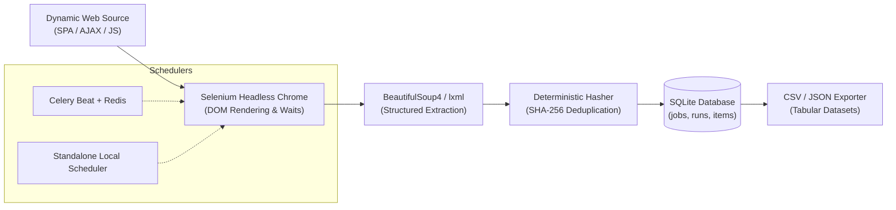
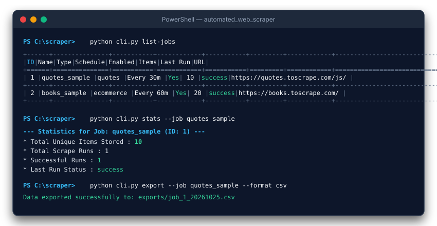

# Automated Web Scraper with Scheduler

[](https://www.python.org/)
[](https://www.selenium.dev/)
[](https://docs.celeryq.dev/)
[](https://www.sqlite.org/)
[](https://www.docker.com/)

An enterprise-ready, automated web scraping tool built with **Python**, **Selenium**, **BeautifulSoup4**, **Celery**, and **SQLite**.

Designed for scraping modern dynamic websites (Single Page Applications, JavaScript-heavy DOMs, infinite scrolling, AJAX pagination) on a periodic schedule, deduplicating records, storing them in SQLite, and exporting clean datasets to **CSV** or **JSON**.

---

## 🏛️ System Architecture


### Pipeline Flow



---

## ✨ Key Features

1. **Hybrid Scraping Pipeline**:
   - **Selenium**: Renders dynamic JavaScript, handles infinite scrolling, executes explicit element waits, and interacts with SPAs.
   - **BeautifulSoup4**: High-speed, resilient parsing of rendered HTML, avoiding slow repetitive WebDriver IPC roundtrips.
2. **Deterministic SHA-256 Deduplication**:
   - Every scraped item is hashed to prevent duplicate entries across recurring scrape runs. Re-scraping the same page updates metadata without bloating your database.
3. **Dual Scheduling Modes**:
   - **Standalone Local Scheduler**: Zero-dependency local scheduler running directly in Python via the `schedule` engine (no Redis required).
   - **Distributed Celery + Redis**: Production distributed architecture with Celery Worker & Beat scheduler.
4. **Pre-built & Generic Dynamic Scrapers**:
   - **Quotes to Scrape (Dynamic JS)**: Demonstration scraper for JavaScript-loaded quotes.
   - **E-Commerce Catalog**: Demonstration scraper for product grids, prices, and stock statuses.
   - **Dynamic Generic Scraper**: Configure any website on the fly by passing CSS selector rules via CLI or JSON!
5. **Interactive CLI & Rich Reporting**:
   - Built-in commands for `init`, `add-job`, `run`, `list-jobs`, `view-data`, `stats`, `export`, and scheduler management.
6. **Multi-Format Export**:
   - One-click export to CSV (flattening nested lists and attributes) or formatted JSON.

---

## 🖥️ Terminal Interface



---

## 📂 Project Structure

```
automated_web_scraper/
├── config.py                 # Configuration settings (paths, Redis URLs, timeouts)
├── database.py               # SQLite schema, migrations, queries, and deduplication
├── exporter.py               # Exporter engine (CSV and JSON)
├── celery_app.py             # Celery application & beat schedule configuration
├── scheduler.py              # Standalone local scheduler engine
├── cli.py                    # Unified Click CLI management tool
├── docker-compose.yml        # Docker compose for Redis and containerized workers
├── Dockerfile                # Container definition with Chromium & driver
├── requirements.txt          # Python dependencies
├── core/
│   ├── engine.py             # Browser automation manager (Selenium Chrome headless)
│   ├── parser.py             # BeautifulSoup parsing and extraction helpers
│   └── scrapers/
│       ├── base.py           # Abstract BaseScraper
│       ├── quotes_scraper.py # Quotes to Scrape (Dynamic JS) implementation
│       ├── ecommerce_scraper.py # Product listing scraper
│       └── dynamic_generic.py   # Config-driven generic dynamic scraper
├── samples/                  # Sample extracted output datasets
│   ├── quotes_sample.csv     # Scraped quotes sample (CSV)
│   ├── quotes_sample.json    # Scraped quotes sample (JSON)
│   ├── ecommerce_sample.csv  # Scraped books catalog (CSV)
│   └── ecommerce_sample.json # Scraped books catalog (JSON)
├── assets/                   # Architecture diagrams & visuals
│   ├── architecture_diagram.svg
│   └── cli_preview.svg
├── tests/
│   ├── test_database.py      # SQLite CRUD and deduplication tests
│   ├── test_parser.py        # BeautifulSoup extraction tests
│   ├── test_scrapers.py      # Scraper logic unit tests
│   ├── test_exporter.py      # CSV and JSON export tests
│   └── test_e2e_live.py      # End-to-end live browser scraping test
└── verify_unattended_scheduling.py # Verification script for unattended scheduling
```

---

## 🚀 Quickstart Guide

### 1. Install Dependencies

Ensure Python 3.10+ is installed:

```bash
pip install -r requirements.txt
```

### 2. Initialize Database & Seed Default Jobs

```bash
python cli.py init
```

### 3. List Configured Jobs

```bash
python cli.py list-jobs
```

### 4. Run a Scraping Job Immediately

```bash
# Run synchronously
python cli.py run quotes_sample

# Or dispatch to background Celery worker
python cli.py run quotes_sample --celery
```

### 5. Inspect Scraped Data & Statistics

```bash
# View table preview in terminal
python cli.py view-data --job quotes_sample --limit 5

# View run statistics & execution history
python cli.py stats --job quotes_sample
```

### 6. Export Data to CSV or JSON

```bash
python cli.py export --job quotes_sample --format csv
python cli.py export --job quotes_sample --format json
```

Exported files are placed in `exports/` by default. See [`samples/`](samples/) for reference outputs.

---

## ⏱️ Scheduling & Unattended Automation

### Mode A: Standalone Local Scheduler (Zero Redis Required)

Best for single-machine setups or local development:

```bash
# Start scheduler and immediately trigger active jobs once
python cli.py schedule --run-now

# Or run with a custom duration (e.g. 1 hour / 3600s)
python cli.py schedule --duration 3600
```

- Synchronizes automatically with SQLite whenever jobs are added or updated.
- Executes each job at its configured interval unattended.

### Verified Unattended Execution

Run the built-in recurring schedule test:

```bash
python verify_unattended_scheduling.py
```

This verifies that the scheduler triggers recurring intervals automatically with zero manual intervention:

```
[3] Inspection Results from SQLite:
    Total Recorded Runs: 2
    * Run #1 (Run ID: 9)  | Status: success | Start: 2026-10-25 14:00:41 | Items: 10
    * Run #2 (Run ID: 10) | Status: success | Start: 2026-10-25 14:00:59 | Items: 10

[4] Interval Verification:
    Delta between Run #1 and Run #2: 18.0 seconds (Target: ~12s)
>>> SUCCESS: Unattended recurring scheduling VERIFIED! <<<
```

---

## 🐳 Docker & Celery Deployment

### Mode B: Distributed Celery + Redis (Production)

For distributed production deployments where scraping tasks are decoupled across worker nodes:

#### Option 1: Docker Compose

Spin up Redis, Celery Worker, and Celery Beat in one command:

```bash
docker compose up -d
```

To run the standalone scheduler in Docker without Redis:

```bash
docker compose --profile standalone up -d
```

#### Option 2: Native Celery on Windows

1. Ensure Redis is running (`redis://localhost:6379/0`).
2. Start the Celery Worker (automatically applies `--pool=solo` on Windows):
   ```bash
   python cli.py worker
   ```
3. In a separate terminal, start Celery Beat:
   ```bash
   python cli.py beat
   ```

---

## 🔧 Adding Custom Scrapers

### Using the Generic Dynamic Scraper (No Code Required)

Configure new sites via JSON selector rules:

```bash
python cli.py add-job \
  --name tech_news \
  --url "https://news.ycombinator.com" \
  --type dynamic_generic \
  --interval 30 \
  --config-json '{"container_selector": ".athing", "fields": {"title": ".titleline > a", "link": {"selector": ".titleline > a", "attribute": "href"}}}'
```

---

## 🧪 Testing

Run all unit tests and live dynamic scraping verification:

```bash
python -m pytest tests -v
```

All 11 tests execute in ~6.5s, verifying:
- SQLite transactions & schema integrity
- SHA-256 deduplication
- BeautifulSoup text and list extraction
- Dynamic scrapers (Quotes, E-Commerce, Generic)
- CSV and JSON exporters
- Live headless Chrome end-to-end rendering
